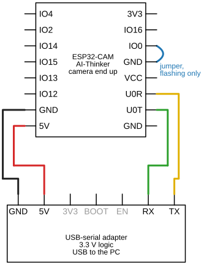

# boresight-cam

Firmware that turns an AI-Thinker ESP32-CAM into Boresight's barrel camera
and physical trigger. It streams to the same server and frame socket as the
phone client, in the same wire format, so nothing on the server changes
depending on which device is aiming.

See the main README's "The ESP32-CAM client" section for wiring, power and
the full walkthrough. This file is the build reference.

## Layout

    main/                     the firmware (ESP-IDF v5.x)
      Kconfig.projbuild       every setting, under "Boresight camera"
      main.c                  boot, configuration check, capture loop
      ota.c                   firmware updates: install, keep, roll back
      link.c                  frame socket: connect, hello, send, telemetry
      camera.c  wifi.c  buttons.c  status_led.c
      camera_fake.c  net_openeth.c  console.c
                              emulator build only: recorded frames,
                              emulated Ethernet, console buttons
    sdkconfig.emulator        the emulator profile's settings (no secrets)
    partitions.csv            both profiles: two firmware slots for updates
                              over Wi-Fi, NVS where it always was
    tools/idf.sh              idf.py inside the pinned ESP-IDF container
    tools/run-emulator.sh     boot an image in QEMU, in the same container
    docs/flashing.py          draws docs/flashing.svg, the flashing wiring
    docs/trigger.py           draws docs/trigger.svg, the trigger wiring
    docs/board.py             the board both diagrams draw
    components/boresight_proto/
                              wire format, debouncer, pin allowlist,
                              back-off and LED patterns -- no ESP-IDF
                              includes, so it is tested on the host
    test_host/                those tests: plain CMake + CTest

## Host tests (no board, no ESP-IDF)

From this directory:

    cmake -S test_host -B build-host
    cmake --build build-host
    ctest --test-dir build-host --output-on-failure

The frame-header vectors in `test_host/test_proto.c` were generated from
`boresight.stream.pack_frame`; the comment above each one is the command.

## Build without installing ESP-IDF

`tools/idf.sh` runs `idf.py` inside the pinned `espressif/idf:v5.4` image,
so the only thing the host needs is Docker (or Podman, with
`CONTAINER=podman`). It runs as you, so the build output is yours to
delete, and it handles rootless Docker.

    tools/idf.sh device build        # the image for a board
    tools/idf.sh emulator build      # the image for QEMU, see below
    tools/idf.sh device menuconfig

The two profiles build into `build/` and `build-emulator/` from separate
configuration. The emulator's `sdkconfig` lives inside `build-emulator/`,
so building it never touches the device's.

A board's Wi-Fi network, server address and port, and token are not
build settings: they are set in
[setup mode](../../README.md#setup-mode) and stored on the board, so no
board image carries them. `menuconfig` has the camera's defaults and ranges,
the pins and TLS. The emulator is the exception: it has no Wi-Fi and
cannot discover the server, so `sdkconfig.emulator` builds in the server
it reaches through QEMU (`10.0.2.2`, port 7391) and the test token, and
the end-to-end suite starts connected.

A `sdkconfig` from before this has Wi-Fi, server and token lines that no
longer apply. Reconfigure once so the build stops carrying them, which
also deletes them from the file:

    tools/idf.sh device reconfigure

## Run without a board

Espressif's open-source QEMU, already inside the same image, runs the
emulator build:

    tools/idf.sh emulator build
    tools/run-emulator.sh

QEMU emulates neither the OV2640 nor the Wi-Fi radio, so the emulator build
swaps in three things and nothing else:

- the sensor: eight frames of the project's Blender scene rendered as the
  ESP32-CAM sees it (`tests/fixtures/esp32cam_video/`), served in order,
  repeating, through the real capture, pacing and send path;
- Wi-Fi: QEMU's emulated Ethernet;
- the trigger pin: console commands. Type `press`, `release` or `click` in
  the emulator's console; they feed the real debouncer and send path.

Type `setup` to restart into setup mode, which a board enters with the
trigger held at power-on (the console only starts after that). With no
radio there is no setup network: the same page is served on the emulated
Ethernet, and `run-emulator.sh` forwards it to
<http://127.0.0.1:7380/> -- loopback only, nothing else on your network
can reach it (`BORESIGHT_EMULATOR_SETUP_PORT` picks another port).
Settings saved there survive the device's restarts for the rest of the
run; every `run-emulator.sh` starts from a freshly merged image, so they
are gone next time.

The emulated device dials `10.0.2.2:7391` with token `emulator-token`:
that is the loopback of the machine running QEMU, so a server bound to
`127.0.0.1` is reached with nothing exposed. For example:

    uv run python -m boresight.server --port 7391 --token emulator-token

The boot log says it is an emulator build, and so does the version it sends
in `hello` (`0.1.0+emulator`), so the server can never mistake it for a
board. Quit QEMU with Ctrl-A X.

`BORESIGHT_EMULATOR_BUILD=build tools/run-emulator.sh` boots the *device*
image instead. It has no Ethernet or fake camera, so it only gets through
its boot checks.

Settings saved there, and firmware uploaded there, survive the device's
restarts for the rest of the run.

To watch a rollback, build an image that resets at every boot, before it
can be kept, into its own directory:

    mkdir -p build-emulator/crash
    echo CONFIG_BORESIGHT_TEST_RESET_AT_BOOT=y > build-emulator/crash/sdkconfig.crash
    tools/idf.sh emulator -B build-emulator/crash \
        -D SDKCONFIG=build-emulator/crash/sdkconfig \
        -D "SDKCONFIG_DEFAULTS=sdkconfig.defaults;sdkconfig.emulator;build-emulator/crash/sdkconfig.crash" \
        build

Upload `build-emulator/crash/boresight-cam.bin` from setup mode: the
device restarts into `ota_1`, resets, and comes back on `ota_0` with
`update to ... in ota_1 did not start: rolled back`.

### The end-to-end suite

    tools/idf.sh emulator build
    BORESIGHT_EMULATOR_TESTS=1 uv run pytest tests/test_firmware_emulator.py

(the second line from the repository root). It boots the emulator image
against the real server with a recording cursor backend, so nothing moves
your mouse, and checks: identification and streaming, with every solved
position one the same frames replay to; trigger press and release; a
server restart, with a press made while it was down never replayed; a
refused token reported and not retried within the 30 s back-off; and setup
mode, where an invalid submission stores nothing and names the field, the
stored token never appears in the page, saving the right token for a
server that refuses the built-in one gets the device streaming again
after its restart, a board image, a cut-off image and a file that is not
firmware are each refused with the reason, and the emulator's own image
installs into the other slot and streams with the stored settings. Without
the variable, a Docker that answers and a built image, the normal `pytest`
run skips it and says which is missing.

It found two bugs before any board existed: a refused token was retried
like a network blip, and a server restart was misread as a certificate
mismatch. Setup mode's tests found two more: an empty field ended the page
early (an empty chunk ends a chunked response), and `esp_restart()` hangs
the restarted image in QEMU, which never starts the second core again, so
the emulator build restarts with a whole-system reset instead.

What emulation cannot tell you: exposure and gain, rolling shutter,
sensor noise, Wi-Fi throughput and latency, the real frame rate, the LED
and brown-outs. Emulated time is not real time, so the frame rate and
round-trip time the emulator reports mean nothing.

## Build and flash with ESP-IDF installed

Requires ESP-IDF v5.1 or later
([install guide](https://docs.espressif.com/projects/esp-idf/en/stable/esp32/get-started/)).

    idf.py set-target esp32
    idf.py menuconfig          # optional: Boresight camera -> Camera, Pins, TLS
    idf.py build

The configuration lands in `sdkconfig`, which is gitignored.
`sdkconfig.defaults` is tracked. Neither holds a secret: the network and
token are set in setup mode once the board is flashed.

The ESP32-CAM has no USB port of its own. Flash through a USB-serial
adapter (3.3 V logic, 5 V to the board's 5V pin), with **GPIO0 held to GND
while it powers up** to enter the bootloader:

    idf.py -p /dev/ttyUSB0 flash monitor

Release GPIO0 and reset the board to run the firmware. Adapters built on
an ESP32-S2 or S3, such as the ESPLink, show up as `/dev/ttyACM0` instead.
The adapter's EN and BOOT lines have nowhere to go: the board's header has
no EN pin, so the jumper does their job.

- VCC is an output: never feed power into it.
- If the board does not answer, move the GND wire to another GND pin.
- If the adapter has no 5V pin, wire its 3.3 V to the board's **3V3**
  pin instead, and check every wire before plugging the adapter in.
  That is enough to flash, but not to run: an ESP-01 adapter's 3.3 V
  output browns the board out once its radio is busy, for instance as
  soon as setup mode opens its network. Run it from 5 V.

The diagram is drawn by `docs/flashing.py` with
[schemdraw](https://schemdraw.readthedocs.io/). After editing it,
regenerate the SVG from the repository root; `uv` fetches schemdraw for
the one run, so the project does not depend on it:

    uv run --no-project --with schemdraw==0.23 \
        python firmware/boresight-cam/docs/flashing.py

## Flashing from a browser, and publishing

The flasher is a page of the project site (`mkdocs.yml` and `website/` at
the repository root), not of the Boresight server. Served locally, it
flashes the build in `build/` from Chrome or Edge over Web Serial:

    uv run --group docs mkdocs serve      # http://127.0.0.1:8000/Boresight/flash/

`BORESIGHT_FIRMWARE=<build or bundle>` picks another build. It writes the
four parts in `flash_args` — never NVS, so stored settings survive —
bundled by `website/flasher.py`. ESP Web Tools is not in the repository:
the first site build fetches it with `tools/vendor-esp-web-tools.sh`, at a
pinned version checked against its SHA-512, and keeps it in
`website/vendor/` (ignored) after that.

CI builds the generic image, with no `sdkconfig` and so no secrets, on
every push (`.github/workflows/firmware.yml`), and for a `v*` tag
publishes a GitHub Release; the tag must match `PROJECT_VER` in
`CMakeLists.txt`. The site, with the latest release in its flasher, is
published on GitHub Pages from `main` (`.github/workflows/site.yml`),
and again once a release is out, to put it in the flasher.

## TLS

With **Connect over TLS** enabled, the build needs the server's certificate
at `main/server_cert.pem` (gitignored) and fails without it:

    cp ../../.boresight/server.crt main/server_cert.pem

The device trusts that certificate and nothing else. At boot it logs the
certificate's SHA-256; the server prints the same figure under `sha256` at
startup. If they differ -- the server's `.boresight/` was regenerated --
copy the certificate again and reflash.
